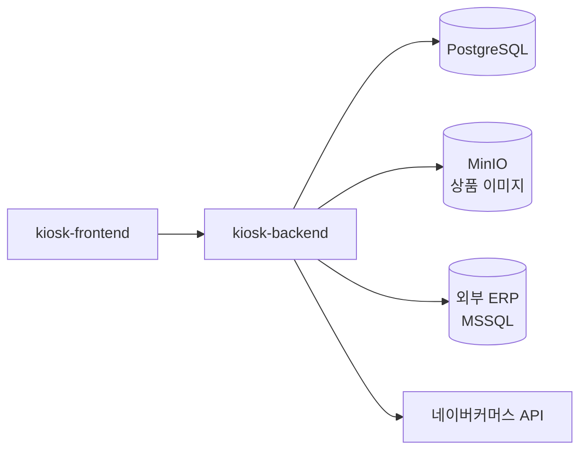

# kiosk-backend

무인 주문 시스템(비전 인식)의 코어 백엔드 — **Spring Boot · PostgreSQL · MinIO · 외부 ERP(MSSQL) · 네이버커머스 연동**

부모님 가게의 인력난을 덜기 위해 기획부터 배포·운영까지 1인으로 개발한 프로젝트입니다.
상품·주문·카테고리 관리, ERP 동기화, 판매 채널 연동, 이미지 스토리지를 담당합니다.

## 시스템 구성

전체 시스템은 4개 서비스로 구성되며, 이 저장소는 그중 코어 백엔드입니다.

| 서비스 | 역할 | 저장소 |
| --- | --- | --- |
| **kiosk-backend** | 상품·주문·ERP 동기화·채널 연동 API | (이 저장소) |
| kiosk-frontend | 주문·관리자 UI (React) | [bapdodi/kiosk-frontend](https://github.com/bapdodi/kiosk-frontend) |
| vision-backend | YOLOv8 상품 인식 · 자가학습 루프 | 비공개 |
| vision-frontend | 비전 검사 UI | 비공개 |



## 핵심 설계

- **판매 채널 연동을 Strategy 패턴으로 추상화** — `SalesChannelConnector` 인터페이스에 채널별 구현체를 붙이는 구조로, 네이버커머스를 연동했고 새 채널 추가 비용은 "구현체 1개"입니다. (`service/channel`, `service/naver`)
- **ERP 옵션조합 동기화 최적화** — 매 동기화마다 전체삭제+재삽입하던 것을 `erpCode` 맵 매칭으로 변경분만 in-place 갱신하고, 상품별 컬렉션은 `@BatchSize(500)` IN 배치 로딩으로 N+1을 제거했습니다. (`ErpSyncService`)
- **ERP 전표번호 계산 최소화** — 품목마다 외부 ERP에 `SELECT MAX(dNO)`를 반복하던 것을 주문 진입 시 1회 계산·고정으로 바꿔 외부 DB 조회를 품목 N회 → 주문당 1회로 줄였습니다.
- **LexoRank 기반 상품 정렬** — 순서 변경 시 두 이웃 사이의 rank 문자열만 갱신하는 O(1) 재정렬로, 드래그앤드롭 낙관적 UI를 지원합니다. (`util/LexoRank`)
- **이미지 캐싱** — 상품 이미지에 `Cache-Control` 7일 + ETag를 부여해 재방문 시 304로 처리합니다. 이미지는 MinIO 오브젝트 스토리지에 저장하며, 로컬 파일 → MinIO 이관용 `StorageMigrationRunner`를 포함합니다.
- **배포** — CI 배포 잡 대신 Watchtower 폴링으로 컨테이너 이미지를 자동 갱신합니다(과거 배포 잡이 운영 `.env`를 덮어쓰던 위험 제거).

## 기술 스택

Java 17 · Spring Boot (Web, Data JPA, Security, Validation) · PostgreSQL · MSSQL(외부 ERP) · MinIO · Docker / docker-compose · Watchtower

## 실행

```bash
# 로컬 (PostgreSQL + ERP용 MSSQL 컨테이너 포함)
docker compose up -d
./gradlew bootRun
```

주요 환경변수 (기본값은 `src/main/resources/application.yml` 참고):

| 변수 | 설명 |
| --- | --- |
| `SPRING_DATASOURCE_URL / USERNAME / PASSWORD` | 서비스 DB (PostgreSQL) |
| `ERP_DATASOURCE_URL / USERNAME / PASSWORD` | 외부 ERP DB (MSSQL) |
| `MINIO_ENDPOINT / ACCESS_KEY / SECRET_KEY / BUCKET` | 이미지 스토리지 |
| `NAVER_COMMERCE_CLIENT_ID / CLIENT_SECRET` | 네이버커머스 API |

## 재고 입고 관리 (ERP 매입전표 직접 기록)

경영박사(DrNet) 클라이언트는 동시접속 2대 제한이 있어 세 번째 담당자가 ERP 를 띄울 수 없습니다.
관리자 화면 `/admin/erp-receiving` 에서 입고를 입력하면 백엔드가 ERP 에 매입전표
(`IL<yy>` `KIND=4`)를 직접 기록합니다. 우리가 넣은 줄은 `BIGO2 = 'KIOSK-IN-<uuid>'` 태그로 구분됩니다.

`ITEM.JEGO`(현재고)는 기본적으로 **건드리지 않습니다**. 운영 데이터에서 기초이월+매입-매출 이
JEGO 와 일치하지 않아(경영박사가 유지하는 파생값), 임의로 더하면 이중가산되거나 재계산에 덮입니다.
복제본에서 경영박사 입고 1건의 before/after 를 대조해 확정한 뒤에만 `stock-mode` 를 바꿉니다.

| 변수 | 기본값 | 설명 |
| --- | --- | --- |
| `ERP_RECEIVING_WRITE_ENABLED` | `false` | 1단계는 읽기 전용(검색/미리보기). 검증 후 `true` |
| `ERP_RECEIVING_STOCK_MODE` | `NONE` | `NONE` \| `JEGO`. JEGO 반영 여부 |
| `ERP_RECEIVING_DATE_WINDOW_DAYS` | `7` | 입고일자를 오늘 ±N일로 제한(월마감 보호) |

별도 멱등 테이블은 필요 없습니다. 같은 요청의 중복 저장과 취소 대상은 원장 줄의 추적 태그(`BIGO2`)로 판단합니다.

운영 배포는 `docker-compose.prod.yml` + Watchtower를 사용합니다.

## 주문 도장 이벤트

신규 주문 접수 시 ERP 고객 코드(상호 계정)별로 도장을 1개 적립한다.
주문 완료 응답의 `stampCount`는 이번 판의 1~5개, `stampRewardEarned`는
이번 주문에서 5개가 완성됐는지를 나타낸다. 6번째 주문은 새 판의 1개부터 시작한다.
비회원 공용 계정(상호명 `1`)과 고객 사본에 없는 코드는 적립하지 않는다.
브라우저가 바뀌어도 PostgreSQL의 `customer_stamp_accounts`에서 적립이 유지된다.
기존 주문에는 소급 적립하지 않으며, 접수 후 취소/삭제해도 적립 카운터는 차감하지 않는다.

`PUT /api/orders/admin/{id}/stamp-reward`는 실제 장갑을 건넨 뒤 지급 완료를 기록한다.
5개 완성 주문만 가능하고 취소 주문은 제외하며, 재호출해도 중복 처리하지 않는다.
관리자 주문 상세에서 지급 버튼을 누를 수 있다. 지급 상태는 해당 주문에 저장된다.

배포 시 백엔드를 먼저 시작해 Flyway `V7__customer_order_stamps.sql`을 적용한 뒤
프런트엔드를 갱신한다. 주문과 적립은 같은 트랜잭션이며, 같은 Idempotency-Key의
재요청에는 원래 도장 결과를 반환한다.

검증: `./gradlew test --tests '*Stamp*' --tests '*OrderServiceTest'`.
실 PostgreSQL 동시성/롤백 테스트는 로컬 검증 DB에 연결하는
`KIOSK_STAMP_DB_URL=jdbc:postgresql://localhost:5433/kiosk`를 설정해 실행한다.
이 테스트는 고유 임시 스키마를 만들고 종료 시 제거한다.

## 손님용 AI 음성 주문

대기 화면/모바일 첫 화면의 **AI 통화**를 누르면 바로 연결되고, 상호 또는 비회원 선택부터
상품·규격·수량 선택과 최종 접수까지 음성으로 진행한다. 기존 화면과 장바구니를 사용하며
직접 터치한 선택은 `get_screen`으로 조회한다. 같은 통화 버튼으로 언제든 종료할 수 있다.

`prepare_review`는 상호·상품·규격·수량을 고정한 확인 ID(2분 유효)를 만든다.
AI가 내용을 읽고 주문 접수 여부를 물은 후 새로 들어온 손님의 명확한 확답이 있어야
`confirm_order`가 기존 `/api/orders`를 호출한다. 부분 인식·부정/수정 응답·내용 변경은 재확인한다.
프런트의 음성 확인 제어이며, 기존 공개 주문 API의 인증/권한 구조는 그대로다.
실제 서버 성공 응답 이후에만 주문번호를 안내하고 통화를 종료한다. 실패 시 재확인 후 같은
Idempotency-Key와 본문으로 재시도한다. 미확인 요청과 다른 본문으로 접수하려 하면 막는다.
완료 안내가 끝날 때까지 완료 화면의 자동 복귀를 잠시 멈춘다. 기존 터치 주문도 사용할 수 있다.
관리자 도구와 결제 기능은 제공하지 않는다.

- 서버의 기존 `GEMINI_API_KEY`를 재사용한다. 브라우저에는 1회용 임시 토큰만 전달한다.
- `AI_ORDER_ENABLED` 기본 `true`; 키가 없거나 `false`이면 버튼을 숨긴다.
- `GEMINI_LIVE_MODEL` 기본 `gemini-3.8-live`. 일반 텍스트용 `GEMINI_MODEL`과 별개다.
- `AI_ORDER_HOURLY_LIMIT` 기본 `60`: 서버 인스턴스 전체의 시간당 세션 발급 상한.
  재시작하면 초기화되는 메모리 제한이므로 여러 인스턴스에서는 게이트웨이의 공통 제한을 사용한다.
- `GET /api/order-voice/status`는 설정 여부만 반환한다.
  `POST /api/order-voice/session`은 캐시 금지, 1회 사용, 새 접속 유효 1분, 토큰 유효 10분이다.
  모델·시스템 지시·손님 도구를 서버에서 고정한다. UI는 9분 이내에 연결을 종료한다.
- HTTPS(개발은 localhost), 마이크/스피커, 브라우저의 마이크 권한과 Google 연결이 필요하다.
  마이크 음성은 Google로 전송하며 이 구현은 대화나 음성을 DB에 저장하지 않는다.
- 종료/닫기/탭 숨김/자리비움 시 마이크·오디오·연결을 해제한다. 오류 시 담은 상품은 유지한다.
- 상품과 규격은 현재 손님용 상품 목록에 있는 ID만 허용한다. 삭제된 규격과 잘못된 수량은
  거절한다. 이름·ERP 코드·가격은 모델의 값을 쓰지 않고 기존 장바구니 처리와 서버 계산을 쓴다.

백엔드를 먼저 반영한 뒤 프런트를 반영한다. 매장에서는 실제 상품명·규격·포장 단위와
주변 소음/스피커 반향을 확인하고 사용한다.
